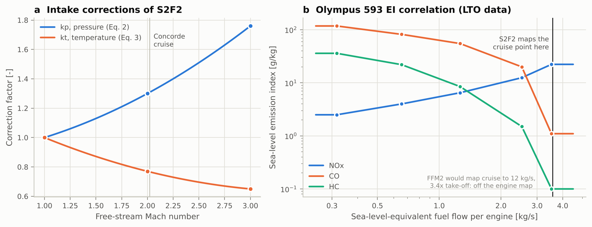
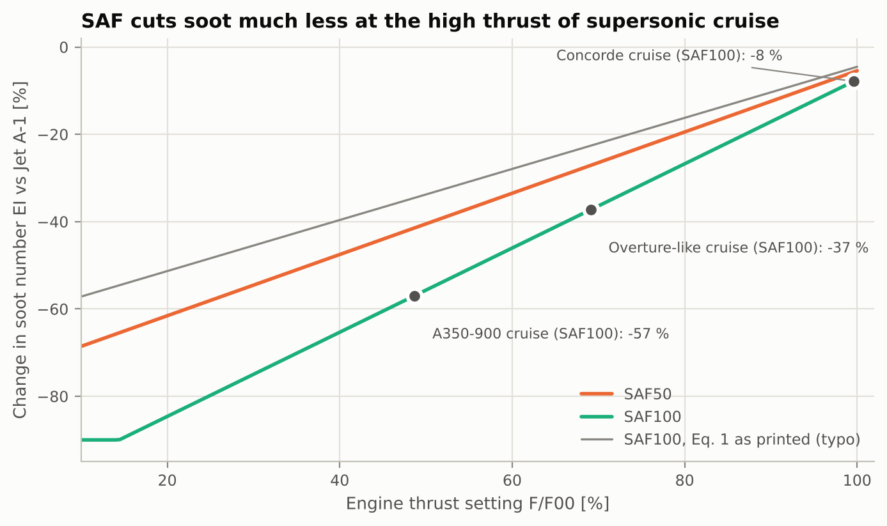
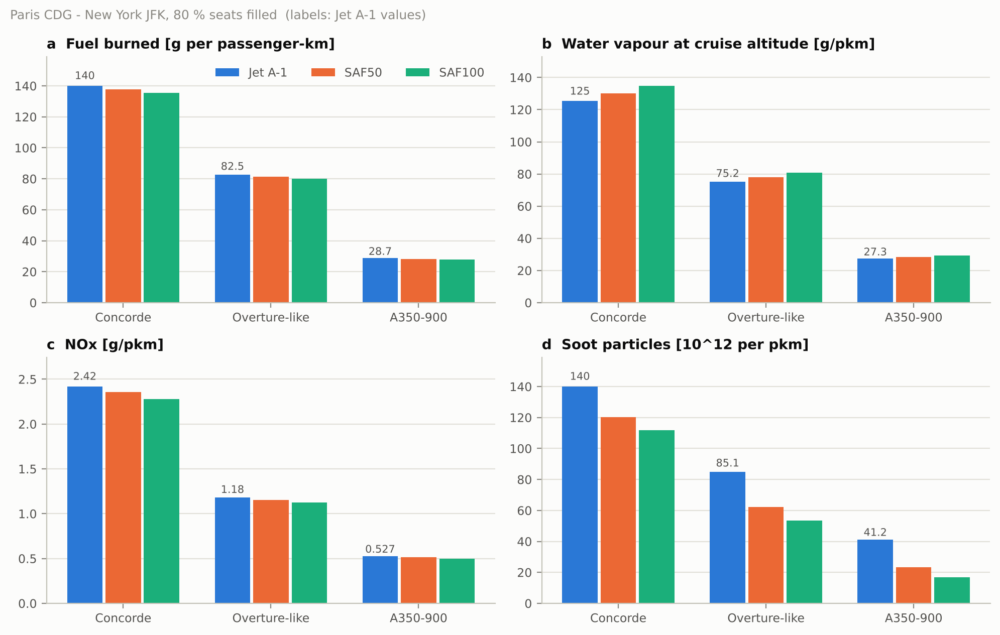
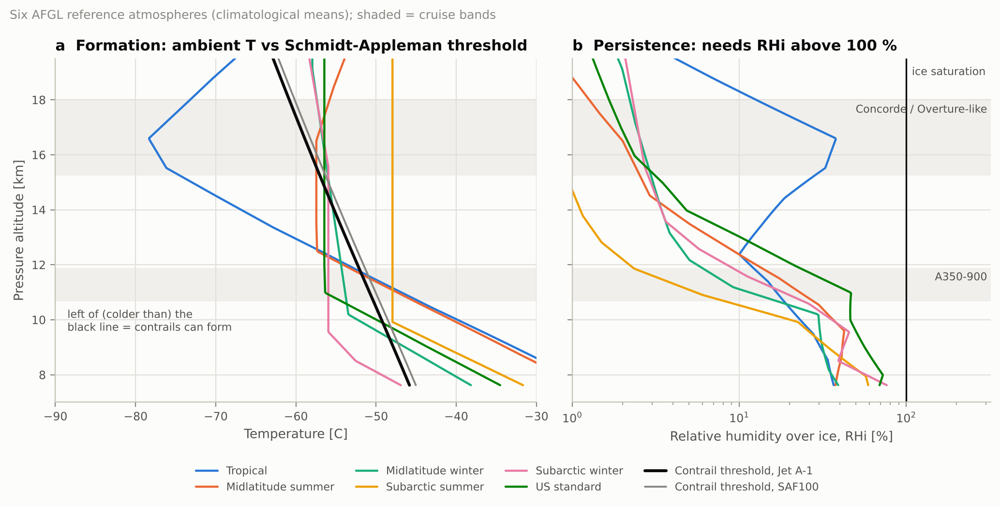
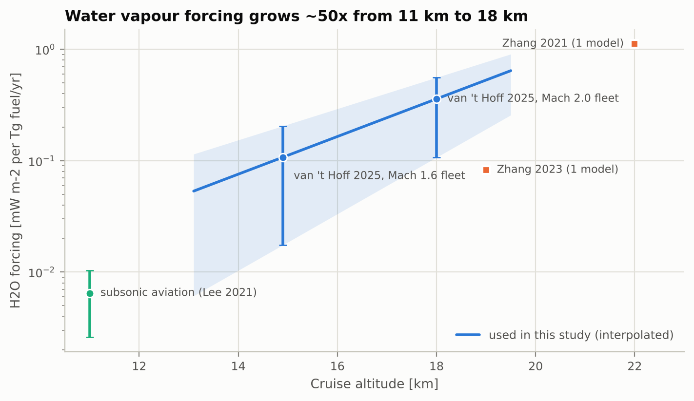
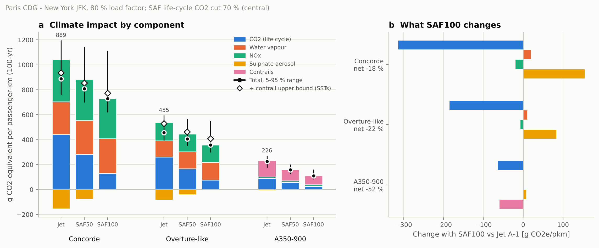
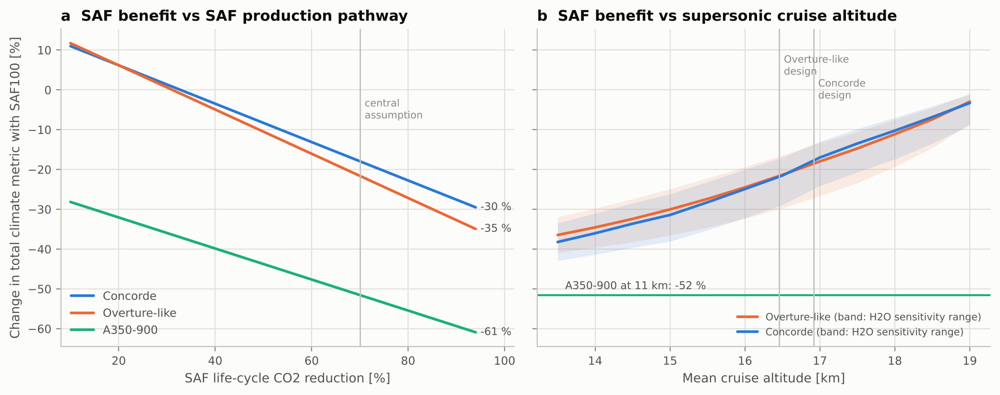

# Step-by-step walkthrough

This document explains what every part of the code does, why, and what comes out. It follows
the order of the analysis: foundations, then Steps 1-4. All numbers below are produced by
`python scripts/run_all.py`. If you change an assumption, re-run it and the tables in
`results/` update.

```
  fuels.py ──┐
atmosphere.py┼──> emissions.py (FFM2 / S2F2 / SAF soot) ──> mission.py ──> climate.py ──> Step 4
  engines.py ┘          ▲  Step 1                        Step 2     ▲
                        │                                           │
                   contrails.py (Schmidt-Appleman, RHi) ── Step 3 ──┘
```

---

## 0. Foundations

### 0.1 Atmosphere (`supersaf/atmosphere.py`)

Both papers need the ambient temperature and pressure at altitude, so we start with the
International Standard Atmosphere. The function `isa(h)` integrates the hydrostatic equation
layer by layer:

* 0-11 km: temperature falls 6.5 K/km, `p = p0 (T/T0)^(-g/(a R))`
* 11-20 km: isothermal at 216.65 K (-56.5 C), `p = p0 exp(-g dh / (R T))`. Every supersonic
  cruise in this study sits in this layer, so the speed of sound, and hence the speed at a given
  Mach, is constant during the cruise-climb.
* 20-32 km: temperature rises again.

`theta_delta(h)` returns the two non-dimensional numbers the fuel-flow methods use:
`theta = T/288.15` and `delta = p/101325`.

The ISA has no humidity, but contrail persistence depends on it. So the module also loads the six
**AFGL reference atmospheres** (Anderson et al. 1986): tropical, mid-latitude summer and winter,
sub-arctic summer and winter, and US standard. Each comes with a water-vapour profile.
`afgl_at_pressure()` interpolates them to a pressure level, linearly in log(p), and the water
vapour in log space because it spans four orders of magnitude.

### 0.2 Fuels (`supersaf/fuels.py`)

A fuel is described by five numbers. The two end members come from Teoh et al. (2022), Table 1:

| | H content | LHV | EI(H2O) | EI(SO2) |
|---|---|---|---|---|
| Jet A-1 | 13.80 % | 43.10 MJ/kg | 1.237 kg/kg | 1.2 g/kg |
| SAF100 | 15.30 % | 44.17 MJ/kg | 1.371 kg/kg | 0 |

Teoh et al. show that these properties are linear in the blending ratio. Fusaro's Eq. 12 says the
same for the LHV. So `make_fuel(blend)` is a linear interpolation, and the test
`test_fuel_blends_match_teoh_table1` checks that it reproduces their SAF10/50/70 rows.

Two derived quantities are used everywhere:

```python
@property
def k_blend(self) -> float:
    """Fusaro Eq. 13: LHV_kerosene / LHV_blend (< 1 for SAF)."""
    return JET_A1["lhv_MJkg"] / self.lhv_MJkg          # 0.976 for SAF100
```

`k_blend` is the fuel mass needed per unit of energy, relative to Jet A-1. SAF100 needs 2.4 %
less mass for the same thrust.

`net_co2_factor(fuel, r)` = `1 - blend * r`. Combustion still emits 3.16 kg CO2 per kg, but for the
SAF share most of it was recently taken from the air by the feedstock. Teoh et al. bound the
life-cycle reduction `r` between 10 % (the certification minimum) and 94 % (FT-SPK from municipal
waste). We use 70 % as the central value and sample 10-94 % in the Monte Carlo.

---

## 1. Step 1: S2F2, the supersonic fuel-flow method (`emissions.py`, `engines.py`)

Run: `python scripts/step1_validate_s2f2.py`

### 1.1 The idea behind every fuel-flow method

We only know an engine's emissions at sea level: the four ICAO certification points (idle,
approach, climb-out, take-off). Emissions are governed by the combustor inlet temperature T3.
The fuel-flow method therefore assumes the following: an engine at altitude with a given T3 emits,
per kg of fuel, like the same engine at sea level with the same T3. So we must:

1. find the **sea-level-equivalent fuel flow** `wf_SL` that gives the same T3;
2. read the sea-level EI at `wf_SL` from the certification data;
3. correct the EI for the different combustor pressure (and humidity) at altitude.

Boeing's FFM2 does this for subsonic flight, assuming an isentropic intake. At Mach 2 that breaks
down: the intake decelerates the flow through shocks, which is not isentropic. S2F2 (Fusaro et
al.) replaces it.

### 1.2 The intake: normal shock plus empirical corrections (Fusaro Eqs. 2-5)

```python
def kp(mach):   # Eq. 2: real intake recovers more pressure than one normal shock
    return np.where(m <= 1.0, 1.0, 0.08 * m**2 + 0.06 * m + 0.86)

def kt(mach):   # Eq. 3: ... and heats the air less
    return np.where(m <= 1.0, 1.0, 0.055 * m**2 - 0.395 * m + 1.34)

def normal_shock_ratios(mach):          # Eqs. 4-5 without kp, kt
    p_ratio = 1 + 2*GAMMA/(GAMMA+1) * (m2 - 1)
    t_ratio = p_ratio * (2 + (GAMMA-1)*m2) / ((GAMMA+1)*m2)
```

At Concorde's Mach 2.02: normal shock `p2/p1 = 4.594` and `T2/T1 = 1.704`; `kp = 1.308` and
`kt = 0.767`. The paper's anchor points (kp = 1.3 and kt = 0.77 at Mach 2; 1.76 and 0.65 at
Mach 3) are unit-tested.

**An interpretation choice.** Equations 7-10 contain the products `kp (p2/p1)` and
`kt (T2/T1)`. We read `p2/p1` and `T2/T1` there as the plain normal-shock ratios, so kp and kt are
applied once. With that reading the code reproduces the paper's CO and HC values exactly (see
1.4), which confirms it.

### 1.3 Sea-level fuel flow and EI corrections (Eqs. 7-10)

```python
theta, delta, kp_pr, kt_tr = s2f2_factors(h_m, mach)   # kp*p2/p1, kt*T2/T1
wf_sl = (r_bleed * wf_alt * theta**3.8 / delta              # Eq. 10
         * (1.0 / kp_pr) * kt_tr**2.95 * (1.0 + 0.2 * m**2))
bracket_co_hc = theta**3.3 / delta**1.02 * (1.0 / kp_pr) * kt_tr**3.3
ei_co  = EI_SL_co(wf_sl)  * bracket_co_hc**x                 # Eq. 7, x = 1
ei_hc  = EI_SL_hc(wf_sl)  * bracket_co_hc**x                 # Eq. 8
ei_nox = EI_SL_nox(wf_sl) * (1/bracket_co_hc)**y * e^H       # Eq. 9, y = 0.4
```

Here are the numbers for Concorde at 54,000 ft, Mach 2.02, 1.5 kg/s per engine:

* `theta^3.8/delta = 3.583`, `1/(kp p2/p1) = 0.166`, `(kt T2/T1)^2.95 = 2.198`, `1 + 0.2 M^2 = 1.816`,
  so `wf_SL = 2.381 x 1.5 = 3.57 kg/s` (12,856 kg/h), just above the take-off point;
* the CO/HC bracket is 1.740. CO and HC rise at altitude because combustion is less efficient
  at low pressure;
* the NOx factor is `1.740^-0.4 = 0.801`. The humidity term is `e^H = 1.128` (Boeing:
  `H = -19 (omega - 0.00634)`, and `omega ~ 0` in the dry stratosphere).

### 1.4 The sea-level EI curve (`engines.py`)

`Engine.ei_sea_level()` reproduces Fusaro's Figure 5: straight lines between the certification
points in log(EI)-log(fuel flow) space, held flat beyond the last point. An EI of zero cannot go on
a log axis, so zeros are floored at 0.1 g/kg, as in their figure. The Olympus 593 table is Fusaro
Table 4. The A350's Trent XWB-84 and the CFM56-7B27E (the Overture proxy) come from the ICAO
databank: `tools/extract_reference_data.py` shows exactly how.



### 1.5 Validation result (`results/tables/table1_s2f2_validation.md`)

| At 54,000 ft, M 2.02 | Measured | Fusaro S2F2 | This code |
|---|---|---|---|
| EINOx [g/kg] | 20.97 | 22.3 (+6 %) | **20.2 (-4 %)** |
| EICO [g/kg] | n/a | 1.9 | **1.91** |
| EIHC [g/kg] | n/a | 0.17 | **0.174** |

* CO and HC match the paper exactly, which confirms the implementation.
* For NOx our value is closer to the measurement than the paper's. The paper's 22.3 g/kg is
  exactly the sea-level take-off EINOx of Table 4, i.e. what you get without the altitude
  correction of Eq. 9. We keep Eq. 9 as published.
* The original FFM2 would map the cruise point to 43,750 kg/h, 3.4 times the take-off fuel
  flow, which is off the engine map. That is why S2F2 is needed above Mach ~1.2.

### 1.6 How SAF enters S2F2

Fusaro's Eqs. 14-17 multiply both `wf_SL` and every EI by `k_blend`, and keep the Jet A-1 fuel
flow. We use an equivalent, more explicit form: feed S2F2 the actual SAF mass flow
(`k_blend` x the Jet A-1 flow) and report EIs per kg of fuel actually burned.
`s2f2_paper_form()` implements Eqs. 14-17 literally, and `test_explicit_saf_form_equals_paper_equations_14_17`
proves that both give the same grams emitted.

Result: with SAF100, EINOx changes by -2 %, while EICO and EIHC rise by about 10 %. The lower
fuel flow moves the operating point down the steep CO/HC curve. This matches the paper's mission
totals: NOx 1118 to 1100 kg, CO 247 to 251 kg.

---

## 2. Step 2: mission fuel burn and emissions (`aircraft.py`, `mission.py`)

Run: `python scripts/step2_mission_emissions.py`

### 2.1 The three aircraft

| | Concorde | Overture-like | A350-900 |
|---|---|---|---|
| Seats / Mach | 100 / 2.02 | 65 / 1.7 | 315 / 0.85 |
| Cruise-climb | 52,000 to 59,000 ft | 50,000 to 58,000 ft | FL350 to FL390 |
| L/D, cruise TSFC | 7.1, 1.195 lb/(lbf h) | **8.5, 1.0 (assumed)** | 18.5, 0.51 |
| Engine data | Olympus 593 (Fusaro T4) | CFM56-7B27E scaled to 35,000 lbf (proxy) | Trent XWB-84 (ICAO) |

Concorde's L/D (7.1, the low end of the 7.1-7.5 literature range) was chosen so that two
independent checks agree within 5 % (`table2b_concorde_checks.md`): full-load fuel economy of
16.6 passenger-miles per US gallon (historical 15.8) and cruise fuel flow at 54,000 ft of
1.51 kg/s per engine (Fusaro Table 3: 1.5). Overture's numbers are assumptions consistent with
Boom's public claims: 60-80 seats, Mach 1.7, up to 60,000 ft, 4 x 35,000 lbf.

### 2.2 The mission model

The mission is taxi/take-off, then climb/acceleration, then a **cruise-climb**, then descent.
Non-cruise segments use textbook weight fractions (Roskam, Table 2.1). A supersonic airliner
keeps 92 % of its weight through climb and acceleration; a subsonic one keeps 98 %. The cruise is
integrated step by step with the Breguet equation, `dW/ds = -c g W / (V L/D)`, backwards from the
known landing weight:

```python
dlnw_ds = c * G0 / (v_nodes * ld)                            # d(ln W)/ds at each node
seg_int = 0.5 * (dlnw_ds[1:] + dlnw_ds[:-1]) * np.diff(s)    # trapezoid per step
w_end = w_land / r_desc
lnw = np.log(w_end) + np.concatenate([np.cumsum(seg_int[::-1])[::-1], [0.0]])
...
thrust_total = w_mid * G0 / ld                # thrust = drag = W / (L/D)
wf_engine = c * thrust_total / ac.n_engines   # kg/s per engine -> input to S2F2
```

At each of the 200 cruise steps we know the altitude, speed and fuel flow per engine, which is
exactly what S2F2 (above Mach 1) or FFM2 (below) needs. Emissions are EI x fuel of each step.
The other segments use certification-cycle EIs.

**SAF in the mission.** The TSFC and the fuel burned in every segment are multiplied by
`k_blend`. The aircraft then also gets lighter, which saves a little more. This "snowball" is why
SAF100 saves 3.1 % of Concorde's fuel mass rather than 2.4 %: fuel is 40 % of its take-off
weight. The test `test_saf_saves_at_least_the_heating_value_ratio` documents this.

### 2.3 Soot: Teoh Eq. 1, and a typo in the paper

The SAF effect on soot particle number depends on hydrogen content and thrust setting:

```python
base = (a0 + a1 * f) * dh                      # a0 = -114.21, a1 = 1.06, f in %
damped = np.where(dh <= 0.5, base, base * np.exp(0.5 * (0.5 - dh)))
return np.clip(damped, -90.0, 0.0)
```

The paper prints the damping as `exp(0.5 - dH)`. That form is not monotonic: SAF100 would cut
soot *less* than SAF70. It also does not reproduce the paper's own Table 2. The authors' code
(pycontrails) uses `exp(0.5 (0.5 - dH))` and clips at -90 %. With that form an effective 54 %
thrust reproduces Table 2 for every blend: -8.5, -25.5, -37.2, -44.7 and -51.1 %, all within
0.7 points. `printed_form=True` gives the printed version. The tests document both.

**This is the link between the two papers.** The thrust setting in Teoh's equation is the
sea-level-equivalent fuel flow divided by the take-off fuel flow, and S2F2 is what gives that
fuel flow for a supersonic engine.



Concorde cruises at ~100 % of its sea-level-equivalent rating, so SAF100 cuts its soot by only
8 %. The Overture-like aircraft at 69 % gets -37 %, and the A350 at 49 % gets -57 %.

### 2.4 Results (`table2_mission_emissions.md`)

| per passenger-km | Concorde | Overture-like | A350-900 |
|---|---|---|---|
| Fuel, Jet A-1 | 140.0 g | 82.5 g | 28.7 g |
| Fuel, SAF100 | 135.6 g (-3.1 %) | 80.1 g (-3.0 %) | 27.9 g (-2.7 %) |
| Water vapour at cruise, Jet / SAF100 | 125 / 135 g | 75 / 81 g | 27 / 29 g |
| Cruise EINOx, Jet A-1 | 19.6 g/kg | 13.8 g/kg | 16.2 g/kg |
| Overall efficiency eta | 0.41 | 0.41 | 0.40 |

SAF raises water vapour at cruise by about +7.5 %: +10.8 % per kg of fuel, partly offset by 3 %
less fuel. The overall efficiency `eta = V/(TSFC x LHV)` is the same for supersonic and subsonic
engines, because the higher flight speed compensates the higher TSFC. It is also fuel-independent.
That matters for Step 3.



---

## 3. Step 3: contrail formation and persistence (`contrails.py`)

Run: `python scripts/step3_contrails.py`

### 3.1 Formation: the Schmidt-Appleman criterion (SAC)

As the hot, humid exhaust mixes with ambient air, its state moves along a straight line in a
(temperature, vapour pressure) diagram. The slope of that line is

```python
G = fuel.ei_h2o * CP_AIR * p / (EPSILON * fuel.lhv * (1.0 - eta))     # Pa/K
```

A contrail forms if that mixing line crosses liquid-water saturation. The line is tangent to the
saturation curve at `T_LM` (Schumann 1996 fit, `t_lm(G)`), so the condition is
`e + G (T_LM - T) > e_L(T_LM)`. For dry air (`e = 0`) the threshold is explicit:
`T_crit = T_LM - e_L(T_LM)/G`.

**Worked example, Concorde at 54,000 ft (9,569 Pa, eta = 0.41, Jet A-1):**
`G = 0.750 Pa/K`, so `T_LM = 223.4 K` (-49.8 C) and `e_L(T_LM) = 6.6 Pa`. Then
`T_crit = 223.4 - 6.6/0.750 = 214.6 K` (**-58.6 C**). The ISA air there is at -56.5 C, which is
2 K too warm: no contrail. With SAF100, `G = 0.811` and `T_crit = -57.9 C`. Formation is slightly
easier (+0.7 K) because of the extra water, but at ISA temperatures it is still not enough.

Low pressure makes the line flat, so at supersonic altitudes the air must be much colder for a
contrail to form. Our implementation agrees with pycontrails' `T_critical_sac` to within 0.2 K
(test `test_cross_check_with_pycontrails`).

> **Correction to my earlier quick estimate in our chat.** The table I gave you before the code
> was written computed `e_L` in hPa instead of Pa. Its "dry-air" thresholds (e.g. -48 C at
> 50,000 ft) were in fact the liquid-saturation values `T_LM`, about 9 K too warm. Table 3 below
> has the correct values. The conclusion changes: in standard-atmosphere air, contrails do NOT
> form at 50,000-60,000 ft.

**Table 3** (`table3_sac_thresholds.md`, eta = 0.40):

| Altitude | p [hPa] | ISA T | Dry threshold, Jet A-1 | ... SAF100 | ISA - threshold | Forms in ISA? |
|---|---|---|---|---|---|---|
| 35,000 ft | 238 | -54.3 C | -50.3 C | -49.6 C | -4.0 K | yes |
| 45,000 ft | 147 | -56.5 C | -54.8 C | -54.1 C | -1.7 K | yes |
| 50,000 ft | 116 | -56.5 C | -57.0 C | -56.3 C | +0.5 K | no |
| 54,000 ft | 96 | -56.5 C | -58.7 C | -58.0 C | +2.2 K | no |
| 60,000 ft | 72 | -56.5 C | -61.2 C | -60.5 C | +4.7 K | no |

### 3.2 Persistence: ice supersaturation

A contrail that forms survives only if the air is supersaturated with respect to ice
(RHi > 100 %). Otherwise the crystals sublimate within minutes. `rhi(T, p, q)` computes it. A more
intuitive number is `T - frost_point(e)`: how much the air would have to cool to become
ice-saturated.

### 3.3 Results in the six reference atmospheres (`table4_reference_atmospheres.md`)

Each aircraft flies at constant **pressure** altitude, as aircraft do, so every atmosphere is
evaluated at the pressures of its cruise band.



* **Formation.** In the supersonic bands the SAC is met only in the tropical atmosphere. The
  tropical tropopause, -78 C at 16.5 km, is the coldest air on Earth outside the polar winter.
  It is met marginally in mid-latitude summer (20-39 % of the Overture band, more with SAF). The
  A350 band meets it in 5 of the 6 atmospheres, fully in 3.
* **Persistence.** At supersonic cruise the extratropical air holds 3-5 ppmv of water, RHi = 1-3 %.
  It would need to cool by **24-34 K** to reach ice saturation, against 6-19 K at subsonic cruise.
  The tropical tropopause layer is the exception: 38 % RHi, 6 K from saturation, where thin
  cirrus does occur.
* Mean profiles never reach 100 % RHi, even at subsonic altitudes, because real
  ice-supersaturated regions are transient. Means can show how far from saturation the air sits,
  but not how often it is supersaturated. That needs ERA5 (3.4).

### 3.4 Going further with ERA5 (optional, `era5.py`, `scripts/download_era5.py`)

The ERA5 download host was not reachable from where this analysis was run, so the code is
included and tested on a synthetic file, but no ERA5 result is shown. On your computer:
`python scripts/download_era5.py` (free Copernicus account), then re-run Step 3. It adds
`table3c` and `fig5` with the share of samples where contrails form and persist, per pressure
level and fuel, optionally with Teoh's humidity correction. Two caveats:

* the correction (`humidity_correction_teoh`: RHi/0.97, boosted with exponent 1.7, capped at 1.7)
  was fitted to aircraft data in the *upper troposphere*, and CoCiP applies no scaling in the
  stratosphere;
* ERA5 tends to be too moist in the lowermost stratosphere.

---

## 4. Step 4: one climate metric (`climate.py`)

Run: `python scripts/step4_climate.py`

### 4.1 From emissions to energy forcing

Contrails act for hours and CO2 for centuries. To add them up, Teoh et al. use **energy forcing**
(EF): radiative forcing integrated over time and over the Earth's surface. For CO2 (their Eq. 3),
`EF = AGWP_100 x m_CO2 x S_earth = 1.49e9 J per kg CO2`.

For water vapour, ozone and aerosols, global-model studies give a *sensitivity*: the sustained
forcing per sustained emission rate, `S = RF / (emission rate)` in mW m-2 per (Tg/yr). For a
species with lifetime tau, `S = (radiative efficiency) x tau`, and the 100-year integral of a 1 kg
pulse is `S (1 - e^(-100/tau)) ~ S`. Hence

```python
EF_PER_SENSITIVITY_UNIT = 1e-12 * SECONDS_PER_YEAR * S_EARTH   # 1.61e10 J/kg per (mW m-2 per Tg/yr)
```

Sanity check: Lee et al.'s water-vapour sensitivity (2.0 mW m-2 for 382 Tg/yr) gives 0.057 x the
EF of CO2, i.e. Lee et al.'s published GWP100 of 0.06 (`test_energy_forcing_constants`). Dividing
any EF by 1.49e9 J/kg gives grams of CO2-equivalent on a GWP100 basis. That is the unit of every
result below.

### 4.2 Where the sensitivities come from (`data/literature_sensitivities.csv`)

| Effect | Value used (range) | Source |
|---|---|---|
| Stratospheric H2O, Mach 1.6 fleet, 13-17 km | 0.11 (0.02-0.21) mW m-2 per Tg fuel/yr | van 't Hoff et al. 2025, 4-model mean (range) |
| Stratospheric H2O, Mach 2.0 fleet, 16.5-19.5 km | 0.36 (0.11-0.56) | same |
| Ozone from supersonic NOx | 15.5 (10.6-33.4) mW m-2 per Tg NO2/yr | van 't Hoff S2 - S1; high: Zhang et al. 2023 |
| Sulphate aerosol, supersonic | -0.08 / -0.17 per Tg fuel/yr (+/-50 %) | van 't Hoff (also Zhang 2023: -0.166) |
| Subsonic H2O, net NOx, sulphate | 0.005, 1.7, -20 (per Tg H2O, NO2, SO2) | Lee et al. 2021 |
| Subsonic contrails | 5.3e10 J per km flown, lower with SAF (Table 2) | Teoh et al. 2022 |
| Supersonic contrails (upper bound) | subsonic x (2 % / 16.2 %) persistence | Gierens et al. 1999, Teoh 2022 |

Water vapour is the key term. Its forcing grows with altitude because its perturbation lifetime
(how long it stays before being flushed out of the stratosphere) grows. We interpolate between the
two van 't Hoff fleets **in log space**, i.e. exponential growth. A straight line would wrongly
drop to zero at 13.6 km:



### 4.3 Putting it together (`ClimateModel.energy_forcing`)

```python
co2 = EI_CO2 * m.fuel_kg * net_co2_factor(fuel, self.p.lca_reduction) * EF_PER_KG_CO2
if ac.supersonic:     # cruise emissions use stratospheric sensitivities at the cruise altitude
    h2o  = cruise["h2o"] * self.h2o_sst_per_kg_h2o(z_km) + other["h2o"] * self.h2o_sub_per_kg()
    nox  = cruise["nox"] * self.o3_sst_per_kg_no2()      + other["nox"] * self.nox_sub_per_kg_no2()
    sulf = cruise["so2"] * self.sulfate_sst_per_kg_so2(z_km) + other["so2"] * self.sulfate_sub_per_kg_so2()
    contrail = 0.0    # upper bound reported separately
else:                 # subsonic: Lee et al. (2021) + Teoh contrail EF per km for this blend
    ...
```

**Result** (`table5_climate_components.md`, g CO2-eq per pkm, 100-yr):

| | CO2 | H2O | NOx | Sulphate | Contrails | **Total** |
|---|---|---|---|---|---|---|
| Concorde, Jet A-1 | 442 | 261 | 340 | -154 | (<= 47) | **889** |
| Concorde, SAF100 | 129 | 280 | 321 | 0 | (<= 44) | **729** (-18 %) |
| Overture-like, Jet A-1 | 261 | 131 | 147 | -83 | (<= 74) | **455** |
| Overture-like, SAF100 | 76 | 141 | 140 | 0 | (<= 50) | **357** (-22 %) |
| A350-900, Jet A-1 | 91 | 2 | 10 | -7 | 132 | **226** |
| A350-900, SAF100 | 27 | 2 | 9 | 0 | 72 | **110** (-52 %) |



### 4.4 Why SAF helps the supersonic aircraft so much less (`table6_saf_effect.md`)

For Concorde, SAF100 changes the metric as follows:

* CO2: -314 g (the 71 % cut)
* water vapour: +20 g
* NOx: -19 g
* **sulphate: +154 g**
* net: -160 g, or -18 %

1. **Dilution.** At 15-18 km, water vapour plus NOx are about as large as CO2, and SAF does
   not reduce them. For the A350 they are under 10 % of the total.
2. **Unmasking.** SAF contains no sulphur, so the sulphate-aerosol *cooling* disappears. In the
   stratosphere, aerosols live much longer than in the troposphere, so this cooling is about 5
   times larger per kg of fuel than for subsonic flight. Without this effect, SAF100 would give
   -35 % (Concorde) and -40 % (Overture-like). Low-sulphur Jet A-1 would also lose this cooling,
   so the effect is not specific to SAF.
3. **No contrail lever.** Half of SAF's benefit on the A350 (-60 g of -117 g) comes from
   shorter-lived contrails. Supersonic aircraft barely make persistent contrails, and at
   near-maximum thrust SAF cuts their soot weakly anyway.

The extra water vapour from SAF (+7.5 %) is real, but it is the smallest of these effects.

### 4.5 Uncertainty: Monte Carlo (`sample_parameters`)

4,000 draws, each sampling every uncertain input from a triangular distribution (low, central,
high): SAF life-cycle cut (10-94 %), H2O sensitivity (one quantile, applied at all altitudes),
ozone, sulphate (+/-50 %), the subsonic terms and subsonic contrails (x0.5-1.5). The same draws are
used for all aircraft, so comparisons between them are paired. Aircraft-performance uncertainty is
*not* included; it would widen the absolute values but hardly the % SAF effect.

| Change with SAF100 | central | 5-95 % |
|---|---|---|
| Concorde | -18 % | -25 to +3 % |
| Overture-like | -22 % | -29 to +3 % |
| A350-900 | -52 % | -57 to -33 % |

In 91 % of draws, SAF100 helps the Overture-like aircraft less than half as much as the A350. In
the pessimistic tail (low life-cycle cut, strong H2O, strong sulphate), SAF can even make a
supersonic aircraft slightly *worse*.

### 4.6 What would change the answer (`fig7`)



* **(a) SAF pathway.** With the best SAF (94 % life-cycle cut), SAF100 gives -30 % (Concorde),
  -35 % (Overture-like) and -61 % (A350). With a 10 % cut it makes the supersonic total worse
  (+11 %).
* **(b) Cruise altitude.** Lowering the Overture-like cruise from 16.5 km to 13.5 km raises the
  SAF100 benefit from -21 % to -37 %, and cuts the Jet A-1 total from 457 to 392 g CO2e/pkm.
  This is the "lower cruise" mitigation of van 't Hoff et al., but the fuel penalty of flying
  lower is not modelled here.

---

## 5. What this means for the feasibility question

* Per passenger-km, a supersonic airliner emits 3-5 times the CO2 of a modern widebody, and
  its non-CO2 effects are of the same size again. SAF cannot close that gap: it shrinks the
  CO2 term but not the stratospheric water and NOx terms. With both fleets on SAF100, the
  Overture-like aircraft goes from 2.2x to 3.5x the A350's impact.
* Two engineering levers emerge from the model: **lower cruise altitudes** (shorter water-vapour
  lifetime) and **low-NOx combustors**. van 't Hoff's low-NOx Mach 1.6 concept is the least
  harmful of their scenarios.
* Contrails are not the problem for supersonic aircraft in the extratropics, although the tropical
  tropopause deserves attention for routes crossing the tropics. For subsonic aircraft they are the
  largest non-CO2 term, which is why SAF works better there.

## 6. Limitations and how to extend

* **S2F2**: one validation point; x and y exponents are defaults (x = 1, y = 0.4). Try `y = 0.5`
  via `s2f2_kwargs` in `fly_mission`.
* **Overture-like aircraft**: assumed L/D, TSFC, weights, and a proxy engine. Change them in
  `aircraft.py`; `fly_mission` also takes `ld_factor` and `tsfc_factor`.
* **Climate sensitivities**: 1-4 models, up to 5x spread; the supersonic NOx term has no methane
  response. Edit `data/literature_sensitivities.csv` to test other studies.
* **Contrails**: no CoCiP simulation above the tropopause. The persistence bound uses MOZAIC
  statistics; ERA5 can replace it.
* **Not included**: aerosol-cloud interactions, black carbon (small, sign uncertain), the fuel
  penalty of lower cruise, routing over land at subsonic speed.
